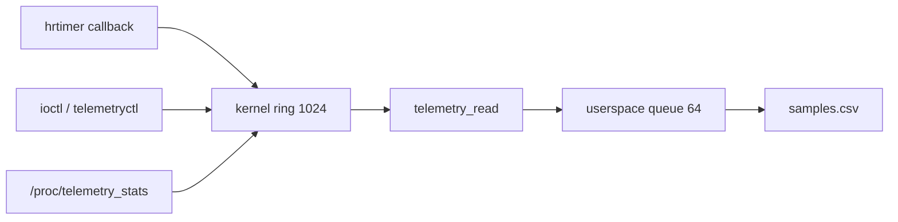

# telemetry-lkm

A small out-of-tree Linux character driver that pretends to be a flight sensor. An `hrtimer` produces fixed 24-byte samples. Userspace reads them from `/dev/telemetry`, queues them between two threads, and writes a CSV.

The host is a Mac. The module is built and loaded only inside an Ubuntu VM. Do not `insmod` on the Mac.

## Problem

A reader that also writes to disk will stall. While it is stalled, a sensor keeps producing samples. This project is the smallest driver that shows that split: a hard-interrupt producer, a ring that drops new samples when it is full, and a userspace reader thread that stays ahead of a slower writer thread.

There is no real sensor. Temperature and pressure are computed from the sequence number.

## Architecture

```
hrtimer (hardirq, only while /dev/telemetry is open)
        |
        | spin_lock_irqsave, drop-newest if full
        v
  kernel ring, 1024 samples
        |
        | read / poll, copy_to_user outside the lock
        v
  reader thread  --mutex + condvars-->  writer thread
  (bounded queue, 64)                    samples.csv
```



| Context | What runs there | May sleep? |
|---|---|---|
| Hardirq | `hrtimer` callback: build one sample, push, wake the wait queue | No |
| Process, syscall | `open`, `read`, `poll`, `ioctl`, `release` | Yes, outside the spinlock |
| Userspace threads | Reader calls `read`. Writer calls `fprintf`. | Yes. They use a mutex, not the kernel spinlock. |

`open` resets the ring and the counters, then starts the timer. `release` cancels the timer before it clears the "in use" flag. Counters stay still while nobody holds the device open.

## Sample and control ABI

One sample is 24 bytes (`include/telemetry_uapi.h`):

| Field | Type | Meaning |
|---|---|---|
| `ts_ns` | `u64` | `ktime_get_ns()` when the sample was built |
| `seq` | `u32` | Ticket number. Increments for every sample the timer creates, including dropped ones |
| `temp_mc` | `s32` | Temperature in millidegrees Celsius |
| `pressure_pa` | `u32` | Pressure in pascals |
| `reserved` | `u32` | Padding, zero |

`read` returns whole records only. A count below 24 bytes returns `-EINVAL`. A blocking read sleeps on a wait queue until a sample exists, or until a signal returns `-ERESTARTSYS`. `O_NONBLOCK` returns `-EAGAIN` when the ring is empty. One `read` copies at most 16 samples.

| Command | Encoding | Effect |
|---|---|---|
| Set rate | `TELEM_IOC_SET_RATE` | 1..10000 Hz. Anything else is `-EINVAL` |
| Get stats | `TELEM_IOC_GET_STATS` | Fills `struct telemetry_stats` |
| Reset | `TELEM_IOC_RESET` | Clears `dropped`, `consumed`, and `high_watermark`. Does not rewind `seq` |
| Anything else | | `-ENOTTY` |

`telemetryctl` opens `/dev/telemetry` itself, so it cannot run while `reader` or `read_one` already holds the device. A second open returns `-EBUSY`.

`/proc/telemetry_stats` prints the same counters without opening the device, so it does not reset them or start the timer.

## Design decisions

The full reasoning is in `DESIGN.md`.

| Topic | Choice |
|---|---|
| Where it runs | Loadable module in an Ubuntu VM only |
| Device node | `miscdevice`, major 10, dynamic minor, mode `0644`, `/dev/telemetry` |
| Records | Binary 24-byte samples, never a partial struct |
| Producer | `hrtimer` on `CLOCK_MONOTONIC`, started in `open`, stopped with `hrtimer_cancel` in `release` |
| Shared state | `spin_lock_irqsave`. The timer is hardirq, so a mutex is illegal there |
| Overrun | Drop the new sample, count it, still advance `seq` |
| Ring | 1024 slots, power of two, free-running head and tail |
| Backpressure in userspace | Reader thread and writer thread, queue capacity 64 |
| Gap | Sum of missing `seq` values in the CSV. The first sample is not a gap |

Drop-newest keeps the oldest samples. Those oldest samples have contiguous `seq`. A short slow run can therefore report `dropped` in the thousands and `gaps=0`. Holes show up in the CSV only after the reader has consumed a full ring and a later slot is reused.

## Build and run

Tested guest: Ubuntu on UTM (Apple Silicon), kernel `7.3.0-10-generic`, aarch64. The shared folder is this repo, mounted in the guest at `/home/adam/Projects/flight-data-logger`.

Install the headers that match the running kernel:

```bash
sudo apt install build-essential linux-headers-$(uname -r) python3
```

The shared folder is often mounted `noexec`. Run the suite with `bash`, not by executing the script directly.

```bash
cd /home/adam/Projects/flight-data-logger
make -C kernel
sudo insmod kernel/telemetry.ko
gcc -Wall -Wextra -Werror -O2 -g -pthread -Iinclude -Iuser \
    user/reader.c user/queue.c -o user/reader
./user/reader
# Ctrl-C writes samples.csv and prints gaps=...
sudo rmmod telemetry
```

`make` may warn that the compiler name differs (`gcc` vs `aarch64-linux-gnu-gcc`) and that `pahole` is missing (`0` vs `131`). Those warnings did not stop the build.

Module parameters:

```bash
sudo insmod kernel/telemetry.ko rate_hz=100
```

`rate_hz` must be 1..10000. `buf_samples` is accepted only when it is 1024, because the array size is fixed in the module. A bad parameter makes `insmod` fail with `Invalid parameters`, and the module stays unloaded.

Other programs:

```bash
gcc -Wall -Wextra -Werror -O2 -g -Iinclude user/telemetryctl.c -o user/telemetryctl
./user/telemetryctl stats
./user/telemetryctl set-rate 1000
./user/telemetryctl reset
cat /proc/telemetry_stats

gcc -Wall -Wextra -Werror -O2 -g -Iinclude user/read_one.c -o user/read_one
./user/read_one
```

`read_one` loops until Ctrl-C or a real error. `EAGAIN` is not an error for it.

`reader` accepts `--device PATH` so the same threads can read a FIFO instead of the kernel device. `TELEMETRY_WRITER_US` makes the writer sleep that many microseconds after each CSV line.

## Tests

From the guest, as root:

```bash
sudo bash tests/run_tests.sh
```

`SECONDS_AT_RATE` defaults to 10. The script builds the userspace programs and the module, runs the queue unit test, loads and unloads 50 times, rejects `rate_hz=0`, checks errno and `poll`, checks contiguous `seq` at 100 Hz and 1 kHz, checks that `rmmod` fails while the device is open, then runs a slow writer and requires `dropped > 0`. It ends by scanning `dmesg` for `BUG:`, `Oops:`, and `cut here`.

One run on kernel `7.3.0-10-generic`, before the slow-writer check was corrected, printed:

| Check | Result |
|---|---|
| Queue unit test | `queue_test ok` |
| Load and unload, 50 times | No `insmod` error |
| `rate_hz=0` | `insmod` rejected the module (`Invalid parameters`) |
| Errno test | `errno_test ok` |
| `poll` | `rc=1 readable=1` |
| 100 Hz, about 10 s | `samples=1001 gaps=0` |
| 1 kHz, about 10 s | `samples=9917 gaps=0` |
| `rmmod` while `reader` is running | `Module telemetry is in use` |
| Writer paused 200 ms, rate still 1 kHz | `gaps=0 dropped=8876` |

That last line is the drop-newest behaviour described above. The script used to require `gaps > 0` and exited there, so the final `dmesg` scan and the `all tests ok` line were not reached on that run. The check now requires only `dropped > 0`.

No latency or CPU benchmark has been measured. There is no benchmark table for that reason.

## Debugging log

Failure-injection experiments (remove the lock, sleep inside the timer, skip `hrtimer_cancel`) have not been run. No oops text is included here.

What did show up during ordinary builds and tests:

- `make -C kernel` from the repo root used to pass `M=$(PWD)`. `PWD` stayed the repo root, so kbuild looked for a Makefile there and failed. The module Makefile now uses `M=$(CURDIR)`.
- Loading the module taints the kernel as out-of-tree and unsigned. That is expected for this module. Proprietary taint is a different flag. Secure Boot rejects an unsigned module; the guest firmware has to allow it.
- A failed `init` returns a negative errno and does not call `exit`. The `rate_hz=0` case is that path: nothing is registered, so there is nothing to free.

## Limitations

- The sensor values are fake.
- One opener. A second `open` returns `-EBUSY`.
- The ring length is fixed at 1024.
- Stock Ubuntu kernels used here do not enable lockdep or KASAN. Races are not detected by the kernel; the `seq` check is the detector this repo uses.
- Numbers above come from one VM run of about 10 seconds per rate, not from a 30 second sweep.
- `hello/` is the Step 0 throwaway module. It is not part of the telemetry driver.

## Next steps

1. Re-run `sudo bash tests/run_tests.sh` and keep the `all tests ok` log.
2. Snapshot the VM, then record the two planned failure experiments: a race with the lock removed, and `msleep` inside the timer callback.
3. `checkpatch.pl`, a build-only CI job, and interview notes in `INTERVIEW.md`.

## How I used AI

An AI agent in Cursor was the tutor and the reviewer. I wrote the kernel core (ring, file operations, locking, ioctl, timer) and the userspace queue and threads, then asked for review when I was stuck. The agent explained the concepts, pointed at bugs, and generated build and test scaffolding such as Makefiles and `tests/run_tests.sh`. Design choices are recorded in `DESIGN.md` so I can defend them without the chat.
